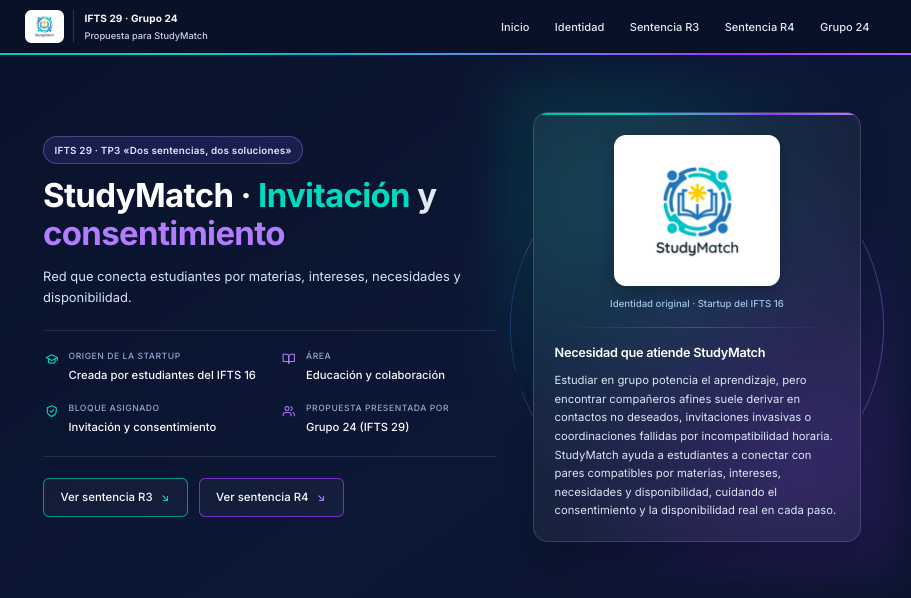
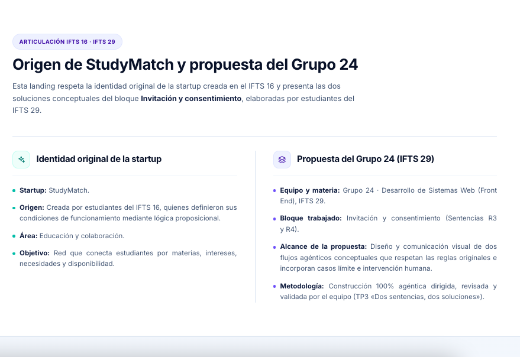
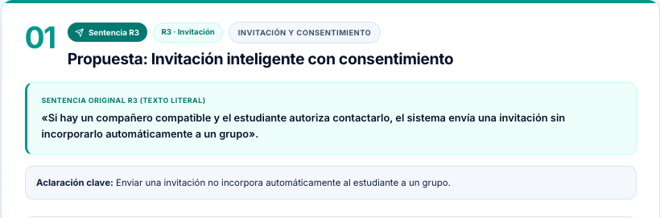
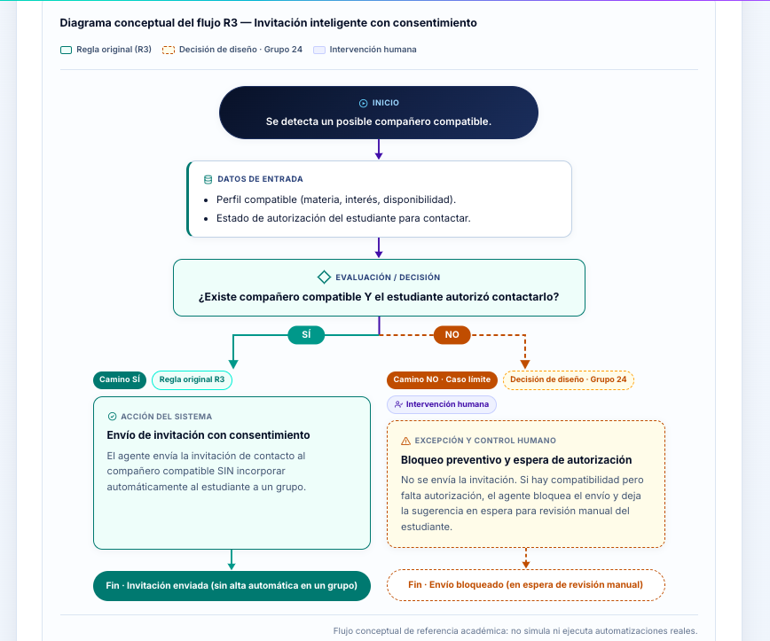
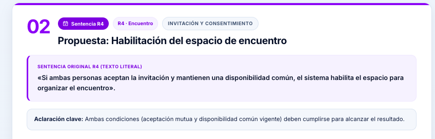
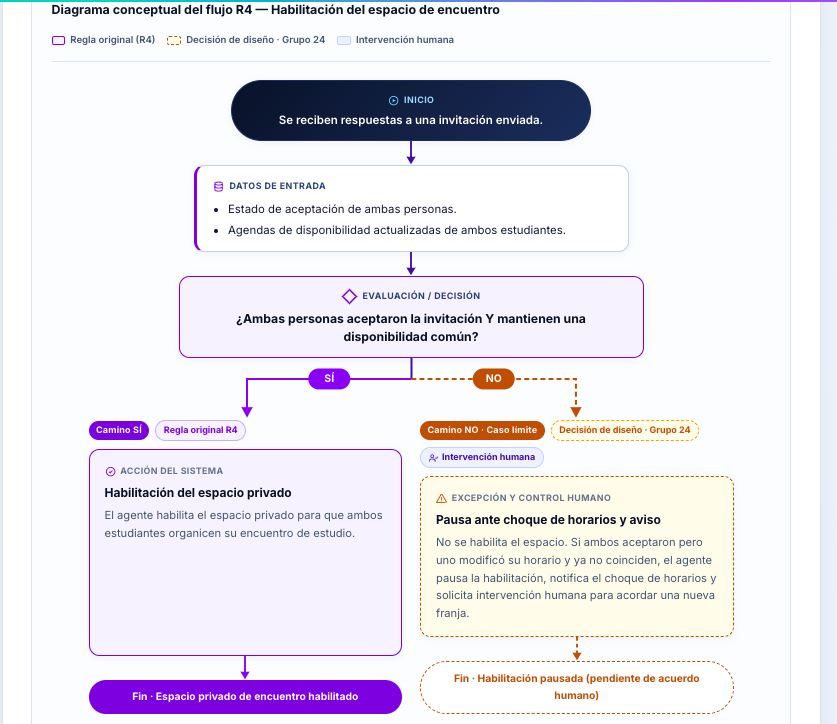
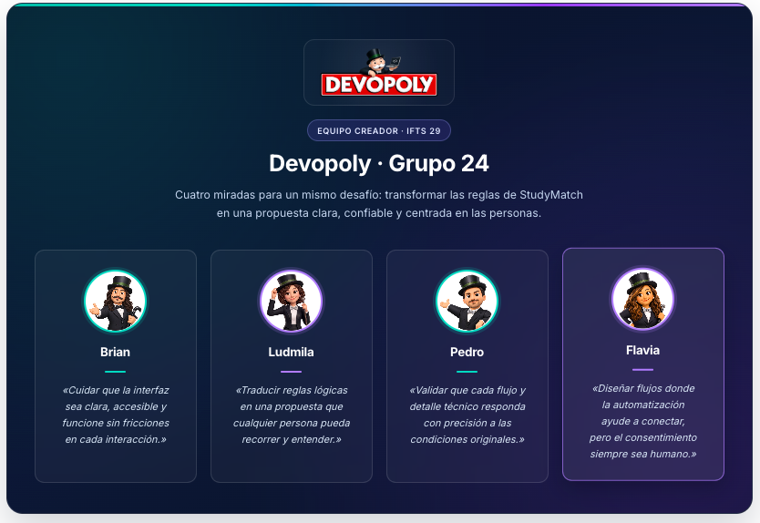

# StudyMatch · Dos sentencias, dos soluciones (TP3)

- **Materia:** Desarrollo de Sistemas Web Front End — IFTS 29 (2026, 2do Cuatrimestre)
- **Equipo:** Grupo 24
- **Fecha de entrega:** 26/11/2026

---

## Enlaces del proyecto
- **Repositorio:** [Peterbusta/TP3_Grupo24](https://github.com/Peterbusta/TP3_Grupo24)
- **Landing publicada:** Pendiente de publicación y verificación.

---

## Startup y bloque asignado
- **Startup:** StudyMatch, creada por estudiantes del IFTS 16.
- **Área:** Educación y colaboración.
- **Objetivo:** Red que conecta estudiantes por materias, intereses, necesidades y disponibilidad.
- **Bloque asignado:** S13-B · Invitación y consentimiento.

### Sentencias originales
- **R3:** «Si hay un compañero compatible y el estudiante autoriza contactarlo, el sistema envía una invitación sin incorporarlo automáticamente a un grupo».
- **R4:** «Si ambas personas aceptan la invitación y mantienen una disponibilidad común, el sistema habilita el espacio para organizar el encuentro».

---

## Integrantes y aportes (Grupo 24)
- **Flavia Berzuini:** Planificación por etapas, redacción de prompts y dirección agéntica (Etapas 1 y 2: estructura base, logo original de StudyMatch, diagramas R3/R4 y desplegables), ajustes de jerarquía textual/identidad institucional y dirección de las iteraciones de rediseño visual EdTech.
- **Pedro Matías Bustamante:** Creación y configuración inicial del repositorio grupal en GitHub (`TP3_Grupo24`), pruebas manuales en navegador Brave y ejecución de la auditoría técnica QA con Antigravity.
- **Brian Savio:** Revisión de avances, resolución de los hallazgos técnicos y de accesibilidad de la auditoría QA (C1, C2, M1, M3, M4, M5 y M6) y validación técnica de la landing.
- **Ludmila Quiroz:** Análisis de consigna y rúbrica, control del cumplimiento de las mismas. Estructuración, redacción y organización de la documentación del proyecto en el `README.md`. Construcción de la sección `Devopoly · Grupo 24`.

### Revisión entre integrantes y mejora concreta
1. **Auditoría QA y correcciones técnicas:** Auditoría ejecutada por Pedro (pruebas manuales en Brave y auditoría solo lectura con `Claude Sonnet 4.6`) y correcciones aplicadas por Brian (favicon, rutas compatibles con subrutas, `scroll-margin-top`, foco visible y accesibilidad de acordeones).
2. **Revisión contra rúbrica y rediseño visual:** Revisión de contenido contra la consigna y la rúbrica por Ludmila, junto con la propuesta de rediseño visual realizada por Flavia en la rama `rediseno-visual`, abierta como Pull Request para revisión y aprobación del equipo antes de integrar a `main`.

---

## Construcción 100% agéntica: herramientas y modelos de IA
Todo el código del proyecto fue generado y modificado exclusivamente mediante instrucciones a un agente de programación, sin edición manual de archivos.

- **Aplicación utilizada:** Antigravity.
- **Modelo seleccionado:** Gemini 4 Neon High.
- **Tecnologías generadas:** React + Vite (HTML, CSS y JavaScript, sin backend, bases de datos ni APIs externas).

### Registro del proceso por etapas
- **Etapa 1 — Estructura base (completada):** Se entregó al agente el encargo inicial con la consigna del TP3, la identidad de StudyMatch (reconociendo su origen en el IFTS 16), el bloque S13-B y las sentencias literales R3 y R4. El agente creó el proyecto en React + Vite, organizó los componentes (`Header`, `HeroSection`, `IdentitySection`, `RuleCard`, `AccordionDetail` accesible con clic y teclado, `TeamSection`, `Footer`), reservó los espacios provisorios para el logo y los diagramas, y validó la compilación inicial sin errores.
- **Etapa 2 — Logo real, diagramas definitivos y desplegables (completada):** Se solicitó al agente eliminar los textos de prueba y placeholders (`LogoPlaceholder.jsx` y `DiagramPlaceholder.jsx`) e integrar el logo original de StudyMatch (`/assets/logo-studymatch.png`, mediante `StudyMatchLogo.jsx`) completo y sin recortes en encabezado y portada. Además, se construyó `FlowDiagram.jsx` con dos diagramas gráficos independientes para R3 y R4 (flechas SVG, bifurcaciones rotuladas SÍ / NO y diferenciación visual entre regla original con trazo sólido y decisiones de diseño/casos límite del Grupo 24 con trazo discontinuo e intervención humana). Completó los desplegables accesibles en `AccordionDetail.jsx` con los 5 bloques requeridos (datos de entrada, herramienta conceptual del agente, condición, acción/resultado y contraste entre regla original y supuestos del grupo) y verificó `npm run build` sin errores.
- **Etapa 3 — Pruebas en desktop e iteración (en curso):**
  - **Herramienta y modelo de auditoría QA:** Gemini (`Gemini 4 Hydrogen`), utilizado para generar un checklist sistemático de verificación en navegador tomando como contexto el repositorio, sus archivos y la consigna del TP3.
  - **Evidencia de uso de IA (checklist de verificación):** Se consultó a `Gemini 4 Hydrogen` para elaborar una guía de control en navegador (aplicada en Brave en `1366×768` / `1920×1080`) orientada a comprobar consola y red, integridad del logo y desbordes horizontales, legibilidad y lógica de los diagramas R3/R4, navegación por teclado y limpieza de textos residuales.
- **Resultado de la verificación humana:**
  1. **Consola y Red:** No se presentan errores en la consola del navegador. En *Network* aún no figura el favicon porque todavía no fue incorporado, pero el logo carga correctamente una primera vez con estado `200` y luego con `304` (reutilización desde caché).
  2. **Integridad del Logo y Desbordes Horizontales:** Se verifica en pantallas *Mobile S* (`320px`), *Mobile M* (`375px`), *Mobile L* (`425px`), *Tablet* (`768px`), *Laptop S* (`1024px`) y *Laptop L* (`1440px`) que el logotipo en el Header y en el Hero no presenta desbordes, cortes ni deformaciones. Asimismo, se verifica ausencia total de scroll horizontal en *Laptop S* (`1024px`), *Laptop L* (`1440px`) y *Laptop XL* (`1920px`).
  3. **Legibilidad y Lógica de los Diagramas (R3 y R4):**
     - En *Mobile S* (`320px`) se detecta un desborde lateral hacia la derecha del texto `"Desplegar / Ocultar detalles"`, quedando recortado por el borde de la pantalla (solucionable apilando las palabras una sobre otra en esa resolución). En el resto de las resoluciones no hay desbordes de texto.
     - En vistas móviles (menores a `720px`), la bifurcación hacia la rama `NO` resulta poco intuitiva visualmente; se propone como mejora que la flecha hacia el `NO` recorra el costado lateral del bloque `SÍ` hacia abajo para evidenciar las dos salidas, o bien evaluar una vista simplificada donde al hacer clic en cada nodo se despliegue el texto completo.
  4. **Navegación Exclusiva por Teclado:** Funciona correctamente en todos los flujos utilizando `Tab`, `Enter` y `Space`; el foco recorre los botones, redirige a las anclas esperadas y abre/cierra los desplegables sin saltos bruscos ni superposiciones con el encabezado.
  5. **Residuos de Etapas Anteriores:** Persisten algunas etiquetas provisorias en el contenido, por lo que su limpieza queda registrada para la siguiente iteración junto con la carga definitiva de los aportes del equipo.
- **Revisión agéntica con Antigravity:**
  - Con la extensión de Antigravity para Visual Studio Code, utilizando el modelo `Claude Sonnet 4.6 (Thinking)` sobre el repositorio local del proyecto, se ejecutó una auditoría técnica mediante un prompt elaborado con apoyo de `Gemini 4 Hydrogen`.
  - **Evidencia de uso de IA (auditoría técnica de código y accesibilidad):** Se instruyó al agente en modo solo lectura sobre `src/`, `public/` e `index.html` para detectar problemas o riesgos en rutas de assets/producción, desbordes y SVG en desktop, `scroll-margin-top` en anclas con header fijo, accesibilidad en acordeones, fidelidad lógica de R3/R4 y textos residuales, clasificados como críticos o mejoras visuales/UX.
  - **Evidencia de respuesta de IA (reporte de auditoría):** El modelo `Claude Sonnet 4.6 (Thinking)` devolvió un reporte técnico de auditoría sobre la rama `etapa-2-diagramas` (`24/11/2026`), sintetizando **3 hallazgos críticos** (ausencia de favicon, ruta del logo incompatible con subrutas y textos provisorios en `TeamSection.jsx` y `content.js`), **7 mejoras visuales/UX** (ajuste de `scroll-margin-top`, `viewBox` del conector SVG, recorte de `:focus-visible` por `overflow: hidden`, uso de `hidden={!isOpen}` en el acordeón, metadatos en `index.html`, texto del ícono del acordeón y verificación de teclado) y las verificaciones sin observaciones, junto con prioridades de cierre.
- **Iteración técnica:** Se implementaron las correcciones aplicables de la auditoría. El estado vigente de cada hallazgo se resume a continuación.

  **Estado actual de los hallazgos de QA:**
  - **Resueltos:** C1 (favicon), C2 (rutas compatibles con subrutas), C3 (eliminados los textos provisorios de `TeamSection.jsx` y `content.js` al integrar la identidad `Devopoly · Grupo 24`, los avatares y las frases del equipo), M1 (margen de desplazamiento), M3 (foco visible del acordeón), M4 (panel oculto con `hidden`), M5 (metadatos) y M6 (texto visible y accesible del acordeón).
  - **Sin cambio necesario:** M2 (el SVG está contenido por el ancho máximo actual y se oculta en móvil) y M7 (el botón nativo ya admite Enter y Espacio).
  - **Pendiente:** Ninguno (todos los hallazgos críticos y mejoras aplicables quedaron resueltos).

- **Iteraciones recientes (sobre `main` y rama `rediseno-visual`):**
  - **Iteración 3.1 — Revisión textual y jerarquía institucional:** Contraste punto por punto con la consigna y la rúbrica; reordenamiento de autoría en el encabezado (`IFTS 29 · Grupo 24` / `Propuesta para StudyMatch`), eliminación del código de sorteo `S13-B` en títulos y etiquetas, reformulación de la sección de articulación IFTS 16 · IFTS 29 y ajuste del pie de página.
  - **Iteración 3.2 — Rediseño visual EdTech (rama `rediseno-visual`):** Incorporación de tipografía `Inter` con suavizado sobre fondos oscuros, paleta diferenciada turquesa (R3) y violeta (R4), unificación de Header/Footer, limpieza del Hero (eliminación de nodos y grilla de puntos, detalle geométrico localizado y botones R3/R4 coordinados).
  - **Iteración 3.3 — Identidad propia del equipo (`TeamSection.jsx`):** Integración opcional de `Devopoly · Grupo 24` (logo propio, avatares y frases de enfoque en panel oscuro glassmorphism) diferenciada de StudyMatch (IFTS 16).

- **Etapa 4 — Documentación final y publicación:** Consolidación de la documentación, registro visual de la interfaz mediante capturas de pantalla y preparación para publicación y verificación.

---

## Capturas de pantalla de la aplicación

A continuación se documenta el aspecto visual de la landing a través de sus distintas secciones y diagramas:

### 1. Inicio (Header y Hero principal)
Barra de navegación fija con autoría institucional (`IFTS 29 · Grupo 24 — Propuesta para StudyMatch`), enlaces ancla, título del bloque asignado (*Invitación y consentimiento*), tarjeta con el logotipo original de StudyMatch (IFTS 16), síntesis de la necesidad que atiende la startup y accesos directos a las sentencias R3 y R4.



### 2. Identidad institucional (Articulación IFTS 16 · IFTS 29)
Contextualización del origen de StudyMatch en el IFTS 16 y el rol del Grupo 24 (IFTS 29) en el modelado funcional y visual de las reglas de negocio del bloque de invitación y consentimiento.



### 3. Sentencia R3 · Invitación inteligente con consentimiento
- **Enunciado de la regla:** Tarjeta `01 · Propuesta: Invitación inteligente con consentimiento`, con el texto literal de R3 y la aclaración sobre la ausencia de alta automática en un grupo.

  

- **Diagrama conceptual del flujo:** Recorrido de invitación y consentimiento, diferenciando el camino `SÍ` (regla original R3) del camino `NO` (caso límite de decisión de diseño del Grupo 24 e intervención humana ante falta de autorización).

  

### 4. Sentencia R4 · Habilitación del espacio de encuentro
- **Enunciado de la regla:** Tarjeta `02 · Propuesta: Habilitación del espacio de encuentro`, con la sentencia literal de R4 y la aclaración sobre el cumplimiento conjunto de aceptación mutua y disponibilidad común vigente.

  

- **Diagrama conceptual y disponibilidad horaria:** Flujo de aceptación mutua y agendas de disponibilidad actualizadas, con habilitación del espacio en el camino `SÍ` y pausa con aviso e intervención humana ante choque o modificación de horarios en el camino `NO`.

  

### 5. Grupo 24 (`Devopoly · Grupo 24` y Footer)
Identidad visual del equipo desarrollador, perfiles y enfoques de cada integrante y pie de página institucional con la referencia al proyecto académico.



---

## Cómo ejecutar el proyecto localmente
Requisitos: Node.js y npm instalados.

1. Clonar el repositorio e ingresar a la carpeta del proyecto:
   ```bash
   git clone [https://github.com/Peterbusta/TP3_Grupo24.git](https://github.com/Peterbusta/TP3_Grupo24.git)
   cd TP3_Grupo24